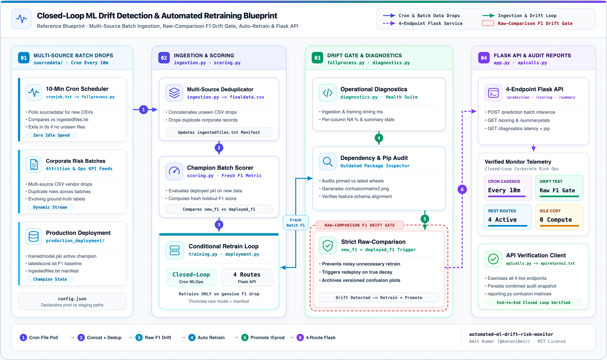
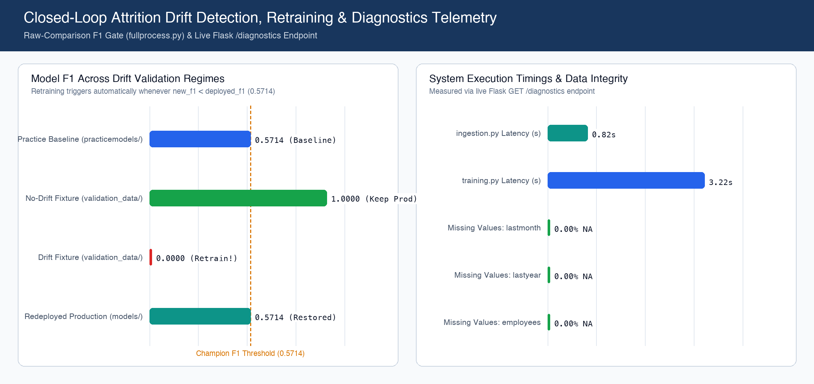
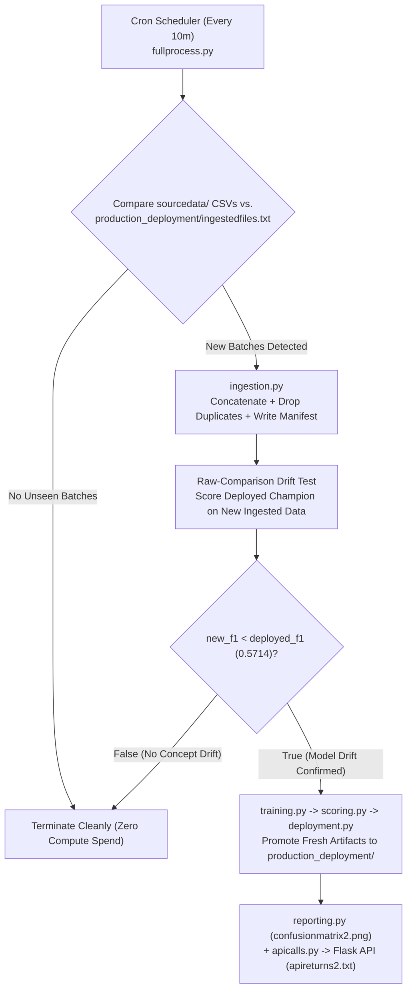
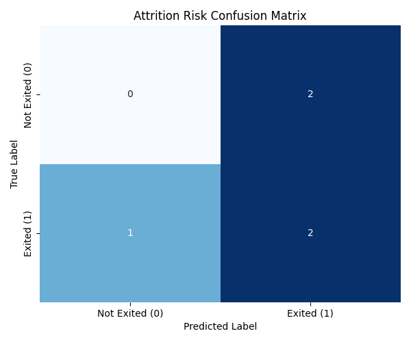

<div align="center">
  
  <br/><br/>
  <p>
    
    
    
    <a href="LICENSE"></a>
  </p>
</div>

---



Closed-loop MLOps dynamic risk assessment and concept-drift remediation system in Python and Flask. Continuously monitors `sourcedata/` via a 10-minute Cron loop (`fullprocess.py`), performs deduplicated multi-source ingestion, evaluates **raw-comparison F1 model drift** against the deployed champion (`production_deployment/latestscore.txt`), conditionally triggers automated retraining + redeployment, regenerates confusion matrices, and captures live diagnostic telemetry across 4 REST endpoints.



---

## 1. Closed-Loop Control Architecture



---

## 2. Practice Baseline vs. Post-Drift Production Confusion Matrices

| Initial Practice Baseline (`confusionmatrix.png`) | Retrained Production Model (`confusionmatrix2.png`) |
| :---: | :---: |
|  |  |

---

## 3. Verified Flask API Telemetry ([`apireturns2.txt`](apireturns2.txt))

Following drift-triggered retraining and redeployment, `apicalls.py` queries all 4 live Flask endpoints (`POST /prediction`, `GET /scoring`, `GET /summarystats`, `GET /diagnostics`):

```json
=== Model Predictions ===
Status: 200
Response:
[
  0,
  1,
  1,
  1,
  1
]


=== Model Score (F1) ===
Status: 200
Response:
0.5714285714285714


=== Summary Statistics ===
Status: 200
Response:
[
  5625.923076923077,
  425.0,
  19444.774621317832,
  763.5384615384615,
  97.5,
  2016.6093569309696,
  457.46153846153845,
  99.0,
  800.604832899189,
  0.5,
  0.5,
  0.5099019513592785
]


=== Diagnostics ===
Status: 200
Response:
{
  "dependencies": [
    [
      "click",
      "8.3.1",
      "8.5.0"
    ],
    [
      "cycler",
      "0.12.1",
      "0.12.1"
    ],
    [
      "Flask",
      "3.1.3",
      "3.1.3"
    ],
    [
      "gunicorn",
      "23.0.0",
      "26.2.0"
    ],
    ...
  ],
  "execution_time": [0.82, 3.22],
  "missing_data": [0.0, 0.0, 0.0, 0.0, 0.0]
}
```

---

## 4. Module Reference & Quick Start

| Module | Responsibility |
| :--- | :--- |
| `ingestion.py` | Scans configured input folder, merges CSVs, removes duplicate rows, and writes `ingesteddata/finaldata.csv` + `ingestedfiles.txt`. |
| `training.py` | Fits regularized `LogisticRegression` on `lastmonth_activity`, `lastyear_activity`, and `number_of_employees` → `trainedmodel.pkl`. |
| `scoring.py` | Computes held-out test F1 score and persists `latestscore.txt`. |
| `deployment.py` | Promotes `trainedmodel.pkl`, `latestscore.txt`, and `ingestedfiles.txt` atomically into `production_deployment/`. |
| `diagnostics.py` | Benchmarks ingestion/training execution latency, column-wise NA rates, summary statistics, and `pip list --outdated` dependency drift. |
| `app.py` / `wsgi.py` | Flask + Gunicorn REST microservice serving `/prediction`, `/scoring`, `/summarystats`, and `/diagnostics`. |
| `fullprocess.py` | Autonomous end-to-end orchestrator invoked every 10 minutes via [`cronjob.txt`](cronjob.txt). |

```bash
python3 -m venv .venv
source .venv/bin/activate
pip install -r requirements.txt

# Start Flask diagnostics & inference server
gunicorn --bind 0.0.0.0:8000 wsgi:app

# Trigger closed-loop drift check & conditional retraining
python fullprocess.py
```

## License

MIT License — see [LICENSE](LICENSE).
