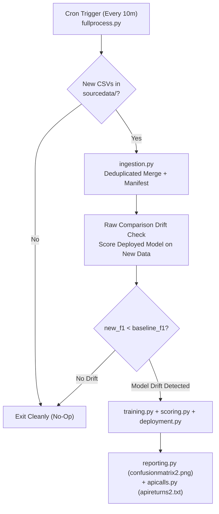

# Automated Corporate Attrition Risk Monitoring, Drift Detection & Retraining Pipeline

Closed-loop MLOps dynamic risk assessment and model monitoring platform in Python and Flask. Automates multi-source CSV data ingestion, raw-comparison F1 concept-drift detection, conditional model retraining and redeployment, dataset/latency/dependency diagnostics, and scheduled reporting via Cron.

---

## Closed-Loop Control Architecture



---

## Operational Highlights & Verified Evidence

| Verification Scenario | Baseline F1 | Evaluated F1 | Automated Action | Verified Artifact |
| :--- | :---: | :---: | :--- | :--- |
| **Initial Practice Run** | — | `0.5714` | Train, deploy & query 4 diagnostics endpoints | [`apireturns.txt`](apireturns.txt), [`confusionmatrix.png`](confusionmatrix.png) |
| **Production Retraining (`sourcedata/`)** | `0.5714` | Drift detected | Automatic retrain, redeploy & API audit | [`apireturns2.txt`](apireturns2.txt), [`confusionmatrix2.png`](confusionmatrix2.png) |
| **Validation Fixture (`no_drift`)** | `0.5714` | `1.0000` | Preserves deployed champion artifact | `validation_data/no_drift/` |
| **Validation Fixture (`drift`)** | `0.5714` | `0.0000` | Triggers full retraining & redeployment | `validation_data/drift/` |

### Flask Monitoring & Diagnostics Endpoints (`app.py` / `wsgi.py`)
- `POST /prediction` — Batch attrition class inference on dataset path.
- `GET /scoring` — Live F1 evaluation of the currently deployed production model.
- `GET /summarystats` — Column-wise `[mean, median, std]` summary statistics (`lastmonth_activity`, `lastyear_activity`, `number_of_employees`).
- `GET /diagnostics` — End-to-end execution latency timings (`[0.82s ingestion, 3.22s training]`), missing-data percentages (`0.0%` across all columns), and automated `pip` outdated-dependency audit table.


---

## Quick Start

```bash
python3 -m venv .venv
source .venv/bin/activate
pip install -r requirements.txt

# Launch the Flask diagnostics & inference API
python app.py

# Execute the automated drift-detection & conditional retraining loop
python fullprocess.py
```

## License

MIT License — see [LICENSE](LICENSE).
